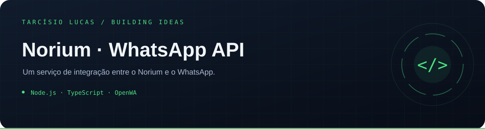

<p align="center"></p>

<p align="center"><a href="https://github.com/T-Lucas43">Perfil</a> · <a href="https://github.com/T-Lucas43?tab=repositories">Mais projetos</a> · <a href="https://www.linkedin.com/in/tarcisio-lucas-io">LinkedIn</a></p>

---

# Norium WhatsApp API

Serviço de API autenticada baseado em `@open-wa/wa-automate`, criada para substituir o gateway terceirizado do Norium sem expor a sessão do WhatsApp ao navegador.

## Segurança

- TLS obrigatório no Azure Container Apps.
- Chaves diferentes para o Norium e para a superfície administrativa completa.
- Comparação constante das credenciais, limites de requisição e envio, validação de payload e teto de mídia.
- Eventos assinados com HMAC-SHA256, timestamp e identificador único.
- Outbox persistente com novas tentativas; sessão e fila são copiadas para um Blob Storage privado a cada 30 segundos.
- Logs com tokens, cookies, QR e dados de sessão removidos.
- Uma única réplica, evitando corrupção ou concorrência da sessão do WhatsApp Web.
- Contexto de sessão assinado pelo backend: cada usuário do Norium recebe worker, QR, credenciais, eventos e armazenamento próprios.
- O navegador nunca escolhe `userId` ou `sessionId`; a identidade vem da autenticação do Norium e é assinada com HMAC entre os serviços.
- Operações destrutivas exigem `X-Confirm-Destructive: true`.

## Superfícies

- `GET /health` e `GET /ready` — sondas da plataforma.
- `/v1/session/*` — status, QR, reconexão e logout.
- `/v1/messages/*`, `/v1/chats`, `/v1/contacts`, `/v1/groups` — integração nativa usada pelo Norium, incluindo histórico paginado, mídia, fotos e metadados de grupos.
- `/v1/openwa/:method` — acesso administrativo aos métodos públicos do cliente OpenWA. Corpo: `{ "args": [] }`.

Autentique com `Authorization: Bearer <chave>` ou `X-API-Key`. A API administrativa exige `ADMIN_API_KEY`; as demais aceitam `NORIUM_API_KEY`. Rotas de sessão também exigem os cabeçalhos internos `X-Norium-User-Id`, `X-Norium-Session-Id` e `X-Norium-Session-Signature`, gerados exclusivamente pelo backend do Norium.

## Execução local

```bash
npm install
npm run build
node dist/server.js
```

Copie `.env.example` para `.env` apenas no seu ambiente local. Segredos nunca devem ser commitados.

## Azure

O template em `infra/` cria um Blob Storage privado cifrado em repouso e a API
com exatamente uma réplica no Container Apps Environment já usado pelo Norium.
O deploy usa uma imagem privada no GHCR identificada pelo SHA do commit; QR,
sessão e outbox são restaurados automaticamente quando a revisão é substituída.

O pipeline de produção é iniciado pelo repositório do Norium porque a identidade
OIDC já autorizada na assinatura está vinculada a ele. O código, a imagem e toda
a infraestrutura desta API permanecem neste repositório separado.

## Aviso

OpenWA automatiza o WhatsApp Web e não é uma API oficial da Meta. Mudanças ou mecanismos antiautomação do WhatsApp podem interromper a sessão ou restringir a conta. Use um número dedicado, limite o volume e respeite consentimento, opt-out e as regras aplicáveis.
